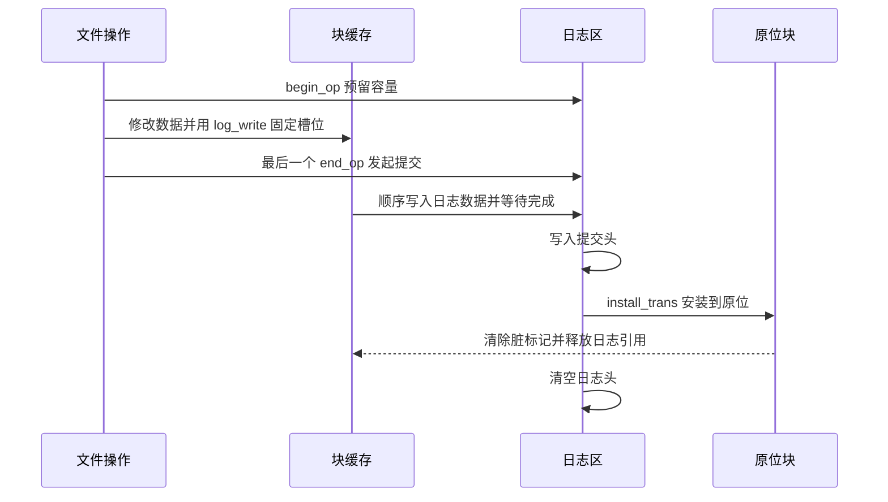

# Lab6 文件系统与崩溃恢复

内核通过 VirtIO 访问磁盘。文件系统由 LFU 块缓存、inode 与目录、预写日志（WAL）组成。启动时先恢复日志，再从磁盘加载 `init`。用户程序通过 `exec` 从文件读取 ELF。

## 磁盘布局

每个文件系统块为 1024 字节，占两个 512 字节扇区。`mkfs` 写入超级块、根目录和程序 ELF。内核从超级块读取各区域的位置和容量。

| 块号 | 内容 |
| --- | --- |
| 0 | 保留块 |
| 1 | 超级块 |
| 2 | 日志提交头 |
| 3–41 | 39 个日志数据块 |
| 42–54 | 磁盘 inode 表 |
| 55 | 块分配位图 |
| 56 起 | 文件数据、目录项和间接索引 |

## 块缓存与 VirtIO

`bio.c` 为根磁盘维护 15 个缓存槽。`bread` 持缓存自旋锁扫描槽位，按磁盘块号查找或绑定缓存。两个请求访问同一块时，第二个请求增加已有槽的引用，再等待该槽的睡眠锁。槽位在读盘前完成绑定，因此两个请求共享同一份块数据。

LFU 优先使用空槽，再从引用数为零的槽位中选择访问频次最低的块。频次相同时淘汰最久未访问的块。新块的首次访问计为 1，每 60 次缓存访问将所有频次减半。查找和选择槽位的时间复杂度为 O(槽位数)。

`log_write` 首次登记原位块时标脏并增加引用。`install_trans` 将已提交的数据同步写回原位，清除脏标记，再释放日志持有的引用。这样脏块在写回前始终留在缓存中。`fscachestat` 检查块号唯一性，并报告命中、淘汰和写回次数。

磁盘 I/O 期间由槽位的睡眠锁保护数据。驱动等待 I/O 时先取得进程锁并登记睡眠状态，再释放设备锁并切换到调度器。完成中断通过同一等待通道唤醒进程，进程锁使登记睡眠与唤醒按序发生。

## 文件、目录与程序加载

| 模块 | 行为 |
| --- | --- |
| `fs.c` | 每个 inode 用 12 个直接块和一个一级间接索引寻址，最多覆盖 268 个数据块。目录项使用 14 字节名称和 16 位 inode 编号，支持绝对路径、相对路径、`.` 和 `..`。 |
| `file.c` | `fork` 和 `dup` 共享打开文件对象及偏移。硬链接共享 inode。删除最后一个名称后，已有描述符继续访问文件，最后一个引用释放时回收 inode 和块。目录删除要求目录为空且没有其他引用。 |
| `proc.c` | 首进程获得调度后读取超级块、恢复日志并加载 `/init`，随后由 `init` 执行 `sh`。`exec` 检查 ELF 文件边界和入口权限，加载各段并构造参数栈，成功后替换原地址空间。 |

挂载时在日志重放之后扫描 inode 表，回收链接数为零的已分配 inode。复位前已取消链接、仍被描述符引用的文件由这一步回收。

## 事务提交

WAL 记录文件数据、目录项、inode、分配位图和间接索引。操作先修改缓存，`log_write` 将同一原位块的多次修改合为一条日志记录。数据按日志区的连续块写入，提交头记录有效块数及每个块的原位地址。

`begin_op` 为每个操作预留 6 个不同块。新建目录最多登记父子两个 inode 块、父目录数据块、父目录间接索引、新目录数据块和共享位图。文件写入按单个数据块拆分事务，所需的 inode、位图和间接索引计入同一预算。

日志容量和缓存固定上限共同限制合批大小。最多固定 12 个缓存槽，留下至少 3 个槽供读盘和提交使用。容量不足或正在提交时，新操作在日志等待通道睡眠。一批操作全部结束后，最后一个 `end_op` 提交。复制时通过一个块大小的工作区中转，每次只锁住一个缓存槽。

命名空间修改先预留事务容量，再获取命名空间锁和 inode 锁。普通文件读写按打开文件对象、inode、缓存块的顺序获取睡眠锁。提交在文件锁与 inode 锁释放后执行。

## 崩溃恢复

提交头落盘是持久化分界。`recover_from_log` 从块 2 读取有效块数。块数为零时直接使用原位块。块数非零时，按提交头记录的地址重新安装全部日志块，完成后清空日志头。重复安装会将相同数据写入相同地址，恢复过程中再次复位仍可继续重放。

`crasharm` 选择事务中的复位位置，由 `crash_at` 触发 QEMU 复位。磁盘使用 `cache=directsync`。写盘阶段的复位点设在同步写入返回后。构建时将 SiFive test 设备的复位写入适配为 32 位。

| 阶段 | 复位位置 | 重启结果 |
| --- | --- | --- |
| 0 | [事务准入前](kernel/log.c#L113) | 保留旧状态 |
| 1 | [事务开始后，首次登记日志块前](kernel/log.c#L116) | 保留旧状态 |
| 2 | [部分日志数据已落盘](kernel/log.c#L144) | 忽略日志区数据，保留旧状态 |
| 6 | [日志数据全部落盘，提交头写入前](kernel/log.c#L146) | 忽略日志区数据，保留旧状态 |
| 3 | [提交头已落盘，原位安装前](kernel/log.c#L148) | 重放得到完整新状态 |
| 4 | [原位块安装到一半](kernel/log.c#L65) | 重放得到完整新状态 |
| 7 | [原位安装完成，日志头清空前](kernel/log.c#L150) | 重放相同数据，保持新状态 |
| 5 | [日志头已清空](kernel/log.c#L153) | 直接读取已安装的新状态 |

## 测试结果

- 八个复位位置分别覆盖文件创建和内容更新。文件创建在提交前不可见，提交后得到长度为零的文件。内容更新在提交前读回 3 字节的 `OLD`，提交后读回 6 字节的 `NEW-V2`。各用例二次启动后的结果一致。
- 孤儿 inode 用例在取消最后一个链接后复位。重启后路径消失，分配位图恢复到用例开始前的状态。断电恢复共 17 个用例通过。
- 单核和双核的 `fsstress`、`fscheck` 均通过，覆盖并发读写、硬链接、跨直接块与间接块的读写、路径解析及删除仍打开的文件。串口高频输入、进程调度、ELF 参数传递与 COW 回归通过。[测试记录](support/lab6-validation.txt)
