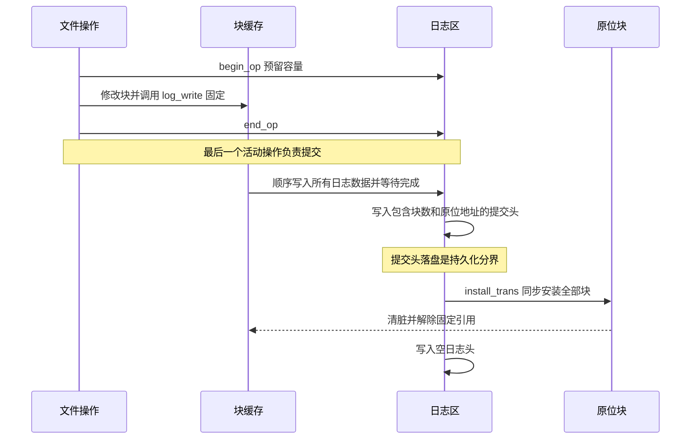

# Lab6 文件系统与崩溃恢复

学号 2024302111375 使用 LFU 块缓存，配置为 15 个槽位。磁盘日志包含 39 个数据块和 1 个提交头块。每块 1024 字节，跨两个 512 字节扇区。镜像的超级块位于块 1，块 2 是日志头，块 3–41 存放日志数据，块 42–54 存放 inode，块 55 存放分配位图，块 56 起存放文件数据、目录项和间接索引。

## 块缓存和驱动

[kernel/bio.c](kernel/bio.c) 在缓存自旋锁内完成查找、引用计数和新块号绑定。查找当前 15 个槽位的时间复杂度为 O(槽位数)。查找也包含已绑定、尚未完成读盘的槽位。同一块的第二个请求增加该槽引用，再等待槽位的睡眠锁。读盘期间没有 cache 自旋锁，只有该块的睡眠锁，因此第二个请求会读到同一份数据。缓存固定为一个根设备，以块号作为唯一键。

替换时只扫描引用数为零的槽位，优先用空槽，再选访问频次最低的槽位。同频时淘汰更早访问的槽位。新块首次访问计数为 1，每 60 次缓存访问统一将已有频次减半，使近期访问逐渐反映在淘汰选择上。频次和最近访问顺序与引用计数使用同一把锁。

事务第一次登记一个原位块时，`log_write` 增加它的引用并标记为脏。提交头落盘后，`install_trans` 同步写盘，写完清除脏标记并解除固定。脏块始终持有固定引用，LFU 只能选择干净槽位。如果零引用槽仍然带脏标记，内核立即报告不变式错误。`fscachestat` 检查槽位身份唯一性并输出命中、淘汰、总写盘和脏块写回计数。

VirtIO 等待以驱动源码使用的通道为准。适配层在释放设备锁之前取得进程锁并登记睡眠状态，再将进程交给调度器。磁盘中断必须取得进程锁才能唤醒，所以等待方释放设备锁后立即完成的 I/O 也能被唤醒。缓存读写、超级块读取和日志恢复均在可睡眠的进程上下文发生。

## inode、目录与磁盘 exec

- `fs.c` 按课程镜像实现 12 个直接块和一个一级间接索引，最多 268 个数据块。创建、分配、修改和回收通过同一个日志提交。目录项使用 14 字节名称和 16 位 inode 编号，逐层解析绝对路径、相对路径、`.` 和 `..`。
- `file.c` 管理普通文件描述符。fork 与 dup 共享打开文件对象及偏移。硬链接共用 inode。最后一个名字删除后，现有描述符仍可读写，最后一个引用关闭时回收 inode 和块。若这期间发生复位，挂载先重放日志，再扫描并回收链接数为零的已分配 inode。仍被使用的目录或非空目录拒绝删除。
- 首进程第一次获调度时读取超级块并恢复日志，然后打开 `/init`。`init` 再 exec 磁盘上的 `sh`。每次 exec 以文件长度为边界检查 ELF、逐段读入新页表，构造 Lab5 参数栈后再替换旧地址空间。构建在暂存目录用程序的短名称交给原版 mkfs，镜像内保存完整 ELF。

## 事务顺序与容量

日志保护文件数据和元数据，包括目录项、分配位图、inode 和间接索引。事务修改先发生在缓存，重复登记同一原位块时合并为一个日志项。日志数据按相邻的日志块顺序写入，使第一轮写入集中于连续地址。安装阶段仍按记录的块号写回各自原位。日志恢复保证断电后的持久化状态，运行时读写由 inode 锁和打开文件对象锁协调。



`begin_op` 按每个操作最多 6 个不同日志块预留。在一次新建目录的最坏路径中，涉及共享位图、父子两个 inode 块、父目录数据块、父目录间接索引及新目录数据块。文件写入按单个数据块有界切分，间接块、inode 和分配位图也计入预算。准入同时检查磁盘日志容量和缓存固定上限。当前至多固定 12 个槽，至少留下 3 个供读盘和提交使用。活跃操作可合批，最后一个 `end_op` 启动提交，提交期间后续操作在日志锁对应的等待通道睡眠。日志复制借助一个块大小的工作区，任一时刻只持有一个缓存槽的睡眠锁。

命名空间的修改先申请事务容量，再取命名空间锁和 inode 锁。普通文件 I/O 按打开文件对象、inode、缓存块的顺序取睡眠锁。日志提交不持有 inode 或文件锁。缓存自旋锁只保护槽元数据，磁盘 I/O 期间释放。关闭最后一个描述符在释放文件表自旋锁后才进入可能写盘的 inode 回收。

## 八个断电切片

`crasharm` 选择日志路径里的断点，实际复位使用课程 `crash_at`。1–5 沿用 `crash.c` 注释中的含义，0、6、7 补充测试。模板把安装完尚未清头写作 stage 5，本实现的对应位置为 stage 7。当前 QEMU 的 SiFive test 寄存器要求 32 位写入，Makefile 从原件生成适配后的编译副本。

| stage | 实际插入点 | 重启后 |
| --- | --- | --- |
| 0 | [事务准入前](kernel/log.c#L113) | 旧状态 |
| 1 | [事务开始后，第一次 log_write 前](kernel/log.c#L116) | 旧状态 |
| 2 | [日志数据写到一半](kernel/log.c#L144) | 旧状态 |
| 6 | [日志数据已全部落盘，提交头写入前](kernel/log.c#L146) | 旧状态 |
| 3 | [提交头已落盘，安装前](kernel/log.c#L148) | 重放至完整新状态 |
| 4 | [原位安装到一半](kernel/log.c#L65) | 重放至完整新状态 |
| 7 | [原位安装已完成，清头前](kernel/log.c#L150) | 再次安装，得到相同的新状态 |
| 5 | [日志头已清空，磁盘提交完成后](kernel/log.c#L153) | 原位直接提供完整新状态 |

恢复从块 2 读取提交头。块数为零时，本轮日志数据无效，磁盘原位仍是旧版或已完成的新版本。块数有效且非零时，根据其中的原位块号重放相应的日志数据。恢复期间若再次复位，日志头会保留到全部原位写入完成，因此下一次可以重放相同的块。QEMU 使用 `cache=directsync`，测试覆盖在同步块写之间触发的受控复位。

自动化把文件创建和文件内容更新分为独立用例。创建提交前路径不可见，提交后出现长度为零的文件。一次内容写入提交前得到 `OLD`（3 字节），提交后得到 `NEW-V2`（6 字节）。单独验证了打开文件后取消链接并复位，重启时能释放其原有数据块。

## 运行与验收

在工程根目录的 WSL shell 中运行以下命令。

```sh
make qemu CPUS=1
python3 support/check_lab6.py
python3 support/inject_uart.py --tree . --script support/tests/lab6-uart.script
python3 support/inject_uart.py --tree . --cpus 2 --script support/tests/lab6-uart.script
python3 support/inject_uart.py --tree . --script support/tests/lab2-uart-regression.script
```

现场验证可在 `sh>` 输入 `fsstress` 与 `fscheck`。演示受控复位时，输入 `fscrash`，根据提示输入 `2w` 或 `4w`，重启后执行 `fsverify`，分别检查旧版和新版。每个演示用例从一致的初始镜像开始，复位前后的镜像文件相同。自动化脚本会为每个用例准备独立镜像，并在恢复后再启动一次检验幂等性。
